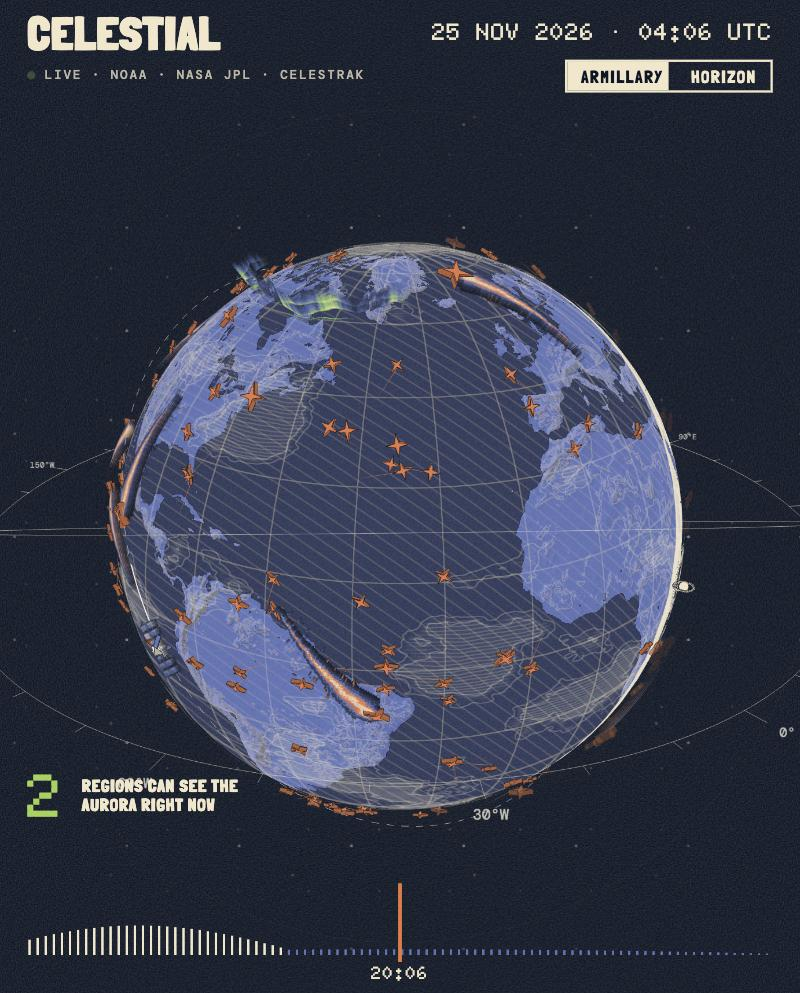
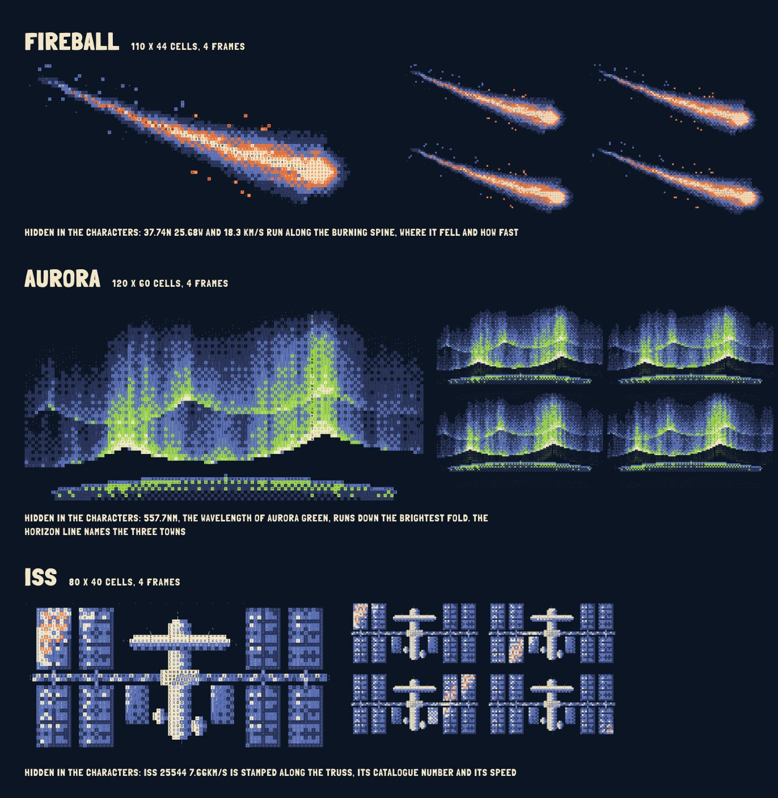

<div align="center">

# CELESTIAL

**The rare things happening in Earth's sky, right now, on one engraved globe.**



🟢 aurora &nbsp;·&nbsp; 🟠 fireballs &nbsp;·&nbsp; ⚪ the ISS

</div>

---

## What you're looking at

| | | |
|:-:|---|---|
| 🟢 | **Aurora** | An ASCII curtain hung round the real auroral oval. Taller where the chance is higher, gone where the sky isn't dark. |
| 🟠 | **Fireballs** | The latest 200 fireballs NASA has logged, each a solid star with its ASCII streak running along the real entry path. |
| ⚪ | **ISS** | The station in its ASCII truss, gliding along its orbit in real time. |

<div align="center">


<sub>Every sprite hides real data in its characters: where a fireball fell and how fast, aurora green's 557.7 nm, the ISS catalogue number.</sub>
</div>

## Play with it

- **Hover** anything. Stars somersault, the station banks, the aurora surges under your cursor.
- **Click** an event to open its card.
- **Drag** the ring on the equator to move the night. Double-click it for real time.
- **Scrub** the timeline at the bottom to move the sun through the day.
- Switch between **Armillary** and **Horizon** views, top right.

## Run it

```bash
npm install
npm run dev
```

## Live data

NOAA SWPC aurora forecast · NASA JPL CNEOS fireballs · CelesTrak ISS orbit. If a feed is down, a saved snapshot fills in, so the globe never goes blank.

<details>
<summary><b>Under the hood</b></summary>

| Path | Role |
|---|---|
| `src/globe/createGlobe.ts` | the globe: engraved Earth, rings, marks, hover |
| `src/globe/interactive.ts` | 3D stars, ISS diamond, night handles, hover labels |
| `src/globe/asciiLayer.ts` | the ASCII sprites, printed into the scene in 3D |
| `src/globe/marks.ts` | fireball entry streaks from JPL velocities |
| `src/ui/` | the poster chrome: wordmark, counter, cards, scrubber |
| `src/data/skyEvents.ts` | every feed, normalized to one `SkyEvent` shape |
| `api/` | Vercel proxies for JPL and CelesTrak |

Clicking an event fires `celestial:select` on `window` with the event (or `null`).

</details>
